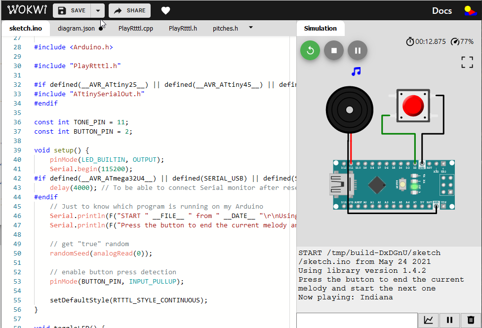

<div align = center>

# [PlayRtttl](https://github.com/ArminJo/PlayRtttl)
Plays RTTTL / RTX melodies and ringtones from FLASH or RAM - blocking or non blocking.<br/>
Improved Arduino library version of the RTTTL.pde example code written by Brett Hagman ([roguerobotics.com](https://roguerobotics.com/)).

[](https://www.gnu.org/licenses/gpl-3.0)
 &nbsp; &nbsp;
[](https://github.com/ArminJo/PlayRtttl/releases/latest)
 &nbsp; &nbsp;
[](https://github.com/ArminJo/PlayRtttl/commits/master)
 &nbsp; &nbsp;
[](https://github.com/ArminJo/PlayRtttl/actions)
 &nbsp; &nbsp;

<br/>
<br/>
[](https://stand-with-ukraine.pp.ua)

Available as [Arduino library "PlayRtttl"](https://www.arduinolibraries.info/libraries/play-rtttl).

[](https://www.ardu-badge.com/PlayRtttl)
 &nbsp; &nbsp;
[](https://github.com/ArminJo/PlayRtttl?tab=readme-ov-file#revision-history)

</div>

#### If you find this library useful, please give it a star.

&#x1F30E; [Google Translate](https://translate.google.com/translate?sl=en&u=https://github.com/ArminJo/PlayRtttl)

<br/>

# Features
- Plays RTTTL melodies / ringtones stored in **FLASH or RAM**.
- **Blocking and non blocking** functions, with optional callback at the end of the melody.
- **Random play** of a melody from an array of melodies.
- 21 sample melodies and 11 Christmas melodies included.
- Functions to print or copy the name of a melody.
- Supports the **RTX format** with the 2 additional options `l` (repetitions) and `s` (style).
- Tone style (ratio of tone length to note length) and number of repetitions can also be set by function call.
- Supports inverted tone pin logic, i.e. the tone pin is HIGH while a pause is played.
- Accepts even slightly invalid RTTTL strings found in the wild, like `h` for `b`, `_` for `#` or a dot after the octave.
- Plays all octaves, including C8 and beyond.

<br/>

# Required resources
- The Arduino `tone()` function and thus Timer 2 on Arduino Uno, Nano etc.<br/>
  On ESP32, `tone()` uses the LEDC peripheral.
- On ATmega328 / ATmega168, the tone pins **11 (OC2A)** and **3 (OC2B)** are toggled directly by hardware.
  Thus the tone is not disturbed by libraries which block interrupts for a longer time, e.g. NeoPixel libraries.
- For the non blocking functions, `updatePlayRtttl()` must be called repeatedly to proceed in the melody.

<br/>

# Demo
YouTube video of the RandomMelody example in action.<br/>
[](https://www.youtube.com/watch?v=0n9_Fm3VP3w)

WOKWI online simulation of the RandomMelody example.<br/>
[](https://wokwi.com/projects/301473936317612552)

<br/>

# Sample code
### Blocking play of a melody stored in FLASH
```c++
#include <PlayRtttl.hpp>
const int TONE_PIN = 11;

void setup() {
    playRtttlBlockingPGM(TONE_PIN, Bond); // Bond is one of the sample melodies defined in PlayRtttl.h
}
void loop() {}
```

### Non blocking play
```c++
    startPlayRtttlPGM(TONE_PIN, TakeOnMe);
    while (updatePlayRtttl()) {
        // your own code here...
        delay(1);
    }
```

### Melody stored in RAM, with callback at end of melody
```c++
char MySong[] = "MySong:d=4,o=5,b=120:c,e,g,c6";

void onMelodyEnd() {
    Serial.println(F("Melody finished"));
}
...
    startPlayRtttl(TONE_PIN, MySong, &onMelodyEnd);
```

### Random melody from one of the included sample arrays
```c++
    startPlayRandomRtttlFromArrayPGMAndPrintName(&Serial, TONE_PIN, RTTTLMelodies, ARRAY_SIZE_MELODIES);
```

<br/>

# Included sample melodies
The sample melodies are defined in [PlayRtttl.h](src/PlayRtttl.h). Unused melodies require no program memory.

| Array | Number of melodies | Size macro |
|-|-:|-|
| `RTTTLMelodies` | 21 | `ARRAY_SIZE_MELODIES` |
| `RTTTLMelodiesSmall` | 11 | `ARRAY_SIZE_MELODIES_SMALL` |
| `RTTTLMelodiesTiny` (e.g. for ATtiny85) | 6 | `ARRAY_SIZE_MELODIES_TINY` |
| `RTTTLChristmasMelodies` | 11 | `ARRAY_SIZE_CHRISTMAS_MELODIES` |

The example melodies may have copyrights you have to respect.

<br/>

# Functions
Functions with suffix `PGM` expect the melody in FLASH (`PROGMEM`).<br/>
Functions with suffix `PGMPGM` expect a pointer to a melody pointer, which itself is stored in FLASH, e.g. `&RTTTLMelodies[i]`.

| Function | Description |
|-|-|
| `startPlayRtttl()`, `startPlayRtttlPGM()`, `startPlayRtttlPGMPGM()` | Start **non blocking** play of a melody. Optional last parameter is a callback function, which is called at the end of the melody. |
| `updatePlayRtttl()` | Must be called repeatedly e.g. in `loop()`. Returns `false` if the melody has ended or was stopped. |
| `playRtttlBlocking()`, `playRtttlBlockingPGM()` | **Blocking** play of a melody. |
| `stopPlayRtttl()` | Stops the current melody. |
| `isPlayRtttlRunning()` | Returns `true` while a melody is playing. |
| `startPlayRandomRtttlFromArray()`, `startPlayRandomRtttlFromArrayPGM()` | Start non blocking play of a random melody of an array. Can copy the name of the melody to a buffer. |
| `startPlayRandomRtttlFromArrayAndPrintName()`, `startPlayRandomRtttlFromArrayPGMAndPrintName()` | Same as above, but prints the name of the melody. |
| `playRandomRtttlSampleBlocking()`, `playRandomRtttlSampleBlockingPGM()` | Blocking play of a random melody of the `RTTTLMelodies` array. |
| `playRandomRtttlSampleBlockingAndPrintName()`, `playRandomRtttlSampleBlockingPGMAndPrintName()` | Same as above, but prints the name of the melody. |
| `getRandomSongPtr()`, `getRandomSongPtrPGM()` | Returns a pointer to a random melody of an array. |
| `printName()`, `printNamePGM()`, `printNamePGMPGM()` | Prints "Now playing: \<name\>" to the `Print` object given as first parameter, e.g. `&Serial`. |
| `getRtttlName()`, `getRtttlNamePGM()` | Copies the name of a melody to a buffer. |
| `setTonePinIsInverted()` | `true` if the tone pin has inverted logic, i.e. it is HIGH while a pause is played. |
| `setNumberOfRepetitions()` | Sets the number of **additional** repetitions of the current melody. Must be called **after** `startPlayRtttl…()`.<br/>The old name `setNumberOfLoops()` is deprecated. |
| `setDefaultStyle()` | Sets the default style divisor (see [Styles](#styles)) for all following melodies, e.g. `setDefaultStyle(RTTTL_STYLE_CONTINUOUS)`. |

`setNumberOfRepetitions()` and `setDefaultStyle()` are not available if `USE_NO_RTX_EXTENSIONS` is defined.

<br/>

# RTTTL format
`<Name>:<Option>,<Option>,...:<Note>,<Note>,...`

Example: `"Short:d=4,o=3,b=240,s=4:c4,8g,8g,a,g.,b,c4"`

### Options
The options can be specified in any order.

| Option | Description | Default |
|-|-|-:|
| `d=` | Default duration of a note: 1 = whole note, 2 = half note, 4 = quarter note, ... 32 | 4 |
| `o=` | Default octave | 6 |
| `b=` | Beats per minute, i.e. quarter notes per minute. Values below 10 are ignored. | 63 |
| `l=` | RTX extension: number of **additional** repetitions. `l=1` plays the melody twice.<br/>Values above 15 are treated as a format error and ignored. | 0 |
| `s=` | RTX extension: style, see [Styles](#styles) | `N` |

### Notes
`<duration><note>[#][.]<octave>[.]`

- **duration** (optional) - 1 = whole note, 2 = half note, 4 = quarter note, etc. If omitted, the default duration is used.
- **note** - `c`, `d`, `e`, `f`, `g`, `a`, `b` (or `h`), or `p` for a pause.
- **#** (optional) - sharp. `_` is accepted as well.
- **.** (optional) - dotted note, i.e. duration is increased by half.
- **octave** (optional) - If omitted, the default octave is used.

See also [RTTTL ringtones with Rhythmic Vibra](https://panuworld.net/nuukiaworld/download/nokix/ringtone.htm).

### Styles
The style determines the length of the tone in relation to the length of the note. The rest of the note is silent.

| RTX style character | Constant for `setDefaultStyle()` | Tone length |
|-|-|-|
| `C` (continuous) | `RTTTL_STYLE_CONTINUOUS` (0) | note length |
| `N` (natural, default) | `RTTTL_STYLE_NATURAL` (16) | note length - 1/16 |
| `S` (staccato) | `RTTTL_STYLE_STACCATO` (2) | note length - 1/2 |
| `2` to `9` | 2 to 9, e.g. `RTTTL_STYLE_4`, `RTTTL_STYLE_8` | note length - 1/digit |

<br/>

# Compile options / macros for this library
To customize the library to different requirements, there are some compile options / macros available.<br/>
These macros must be defined in your program **before** the line `#include <PlayRtttl.hpp>` to take effect.<br/>
Modify them by enabling / disabling them, or change the values if applicable.

| Name | Default value | Description |
|-|-:|-|
| `USE_NO_RTX_EXTENSIONS` | disabled | Disables interpretation of the RTX options `s` (style) and `l` (repetitions).<br/>Even with `USE_NO_RTX_EXTENSIONS` activated, the style is natural (tone length = note length - 1/16).<br/>Saves up to 322 bytes program memory. |
| `RTX_STYLE_DEFAULT` | `'N'` | Default style used if a melody has no `s` option. Valid values are `'C'`, `'N'`, `'S'` and `'2'` to `'9'`, see [Styles](#styles). |
| `SUPPRESS_HPP_WARNING` | disabled | Suppresses the warning if you include `PlayRtttl.h` instead of `PlayRtttl.hpp`. |
| `DEBUG` | disabled | Prints the parsed options of each melody to `Serial`. |
| `TRACE` | disabled | Additionally prints each played note to `Serial`. |

### Changing include (*.h) files with Arduino IDE
First, use *Sketch > Show Sketch Folder (Ctrl+K)*.<br/>
If you have not yet saved the example as your own sketch, then you are instantly in the right library folder.<br/>
Otherwise you have to navigate to the parallel `libraries` folder and select the library you want to access.<br/>
In both cases the library source and include files are located in the libraries `src` directory.<br/>
The modification must be renewed for each new library version!

### Modifying compile options / macros with PlatformIO
If you are using PlatformIO, you can define the macros in the *[platformio.ini](https://docs.platformio.org/en/latest/projectconf/section_env_build.html)* file with `build_flags = -D MACRO_NAME` or `build_flags = -D MACRO_NAME=macroValue`.

### Modifying compile options / macros with Sloeber IDE
If you are using [Sloeber](https://eclipse.baeyens.it) as your IDE, you can easily define global symbols with *Properties > Arduino > CompileOptions*.<br/>


<br/>

# Running with 1 MHz
If running with 1 MHz, e.g. on an ATtiny, the `millis()` interrupt needs so much time that it disturbs the interrupt driven `tone()` generation.
You can avoid this by using a tone pin which is directly supported by hardware.
Look at the appropriate *pins_arduino.h*, find `digital_pin_to_timer_PGM[]` and choose pins with TIMER1x entries.

# Compiling for ATtinies
In order to fit the examples into the 8K flash of ATtiny85 and ATtiny87, the [Arduino library ATtinySerialOut](https://github.com/ArminJo/ATtinySerialOut) is required for these CPUs.

# More songs
- More RTTTL songs can be found at [picaxe.com](https://picaxe.com/RTTTL-Ringtones-for-Tune-Command/) or ask Google.
- [C array of songs on GitHub](https://github.com/granadaxronos/120-SONG_NOKIA_RTTTL_RINGTONE_PLAYER_FOR_ARDUINO_UNO/blob/master/RTTTL_PLAYER/songs.h)

<br/>

# Revision History
### Version 2.3.0
- Fixed: last melody of an array was never chosen by the random functions.
- Fixed: check of default octave, `b#` and `h#`, `millis()` overflow, garbage output of `printName()` for melodies in RAM.
- Fixed: direct hardware toggle at pin 11 / 3 is only used for ATmega328 / 168 (not for Mega).
- Changed: ESP32 now uses `tone()` / `noTone()`.
- Changed: renamed `setNumberOfLoops()` to `setNumberOfRepetitions()`. The old name is deprecated.
- Changed: `l=N` now means N **additional** repetitions.
- Added: `RTX_STYLE_DEFAULT` compile option, new functions `getRandomSongPtr()` and `getRandomSongPtrPGM()`.

### Version 2.2.0
- Converted to use ESP32 version 3.x.
- Added switch to direct hardware toggle output at OC2B / pin 3.

### Version 2.1.0
- Added ability to play C8 and beyond.

### Version 2.0.1
- Added function `isPlayRtttlRunning()`.

### Version 2.0.0
- Renamed PlayRtttl.cpp to PlayRtttl.hpp.
- Removed macros `SUPPORT_RTX_EXTENSIONS` and `SUPPORT_RTX_FORMAT`.

### Version 1.4.2
- New example ReactionTimeTestGame.

### Version 1.4.1
- Removed blocking wait for ATmega32U4 Serial in examples.

### Version 1.4.0
- Supporting direct tone output at pin 11 for ATmega328. Can be used with interrupt blocking libraries for NeoPixel etc.
- Use `Print *` instead of `Stream *`.
- Improved non-AVR compatibility.
- New Christmas songs example.

### Version 1.3.0
- Support all octaves below 8.
- New styles `'1'` to `'9'` in addition to RTX styles `'C'`, `'N'`, `'S'`.

### Version 1.2.2
- Tested with ATtiny85 and 167.
- Ported to non AVR architectures.

### Version 1.2.1
- Natural is the new default style.
- New `RTTTLMelodiesSmall` sample array with less entries.
- Parameters are now order independent.
- Modified `OneMelody` example.

### Version 1.2.0
- No Serial.print statements in this library anymore, to avoid problems with different Serial implementations.
- Functions `playRandomRtttlBlocking()` and `startPlayRandomRtttlFromArrayPGM()` do not print the name now. If needed, use the new functions `playRandomRtttlSampleBlockingAndPrintName()` and `startPlayRandomRtttlFromArrayPGMAndPrintName()`.
- Printing functions have a `Stream *aSerial` parameter to print to any serial. Call them with `&Serial` to use the standard Serial.
- `playRandomRtttlBlocking()` renamed to `playRandomRtttlSampleBlocking()` and bug fixing.

### Version 1.1.0
- RTX song format support.
- New `setNumberOfLoops()` and `setDefaultStyle()` functions.

### Version 1.0.0
- Initial Arduino library version.

<br/>

# CI
The library examples are tested with GitHub Actions for the following boards:

- arduino:avr:uno
- arduino:avr:leonardo
- arduino:avr:mega
- ATTinyCore:avr:attinyx5:chip=85,clock=1internal
- ATTinyCore:avr:attinyx7micr:sketchclock=1external16
- esp8266:esp8266:huzzah:eesz=4M3M,xtal=80
- esp32:esp32:featheresp32:FlashFreq=80
- STMicroelectronics:stm32:GenF1:pnum=BLUEPILL_F103C8
